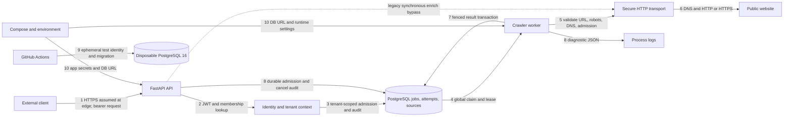

# SEC/OPS Gate 1B.2-A — architecture and trust baseline

## Scope and evidence rule

Baseline at `36febdeed296b10c69b7123854f108546a9f5f25` on
`feature/build-006a-secure-crawler`. This is a repository review, not a running
deployment inspection. `IMPLEMENTED` means present in current code or manifests;
`TESTED` means a named test covers the stated behavior; `NOT VERIFIED` means
effective deployment behavior has no evidence; `NOT IMPLEMENTED` means the
repository lacks the control. Earlier Gate 1 infrastructure reports described
an older tree without a dedicated crawler worker. Current code and Compose take
precedence. Gate [1B.1-R3](SEC_OPS_GATE_1B1_R3_FINAL_ACCEPTANCE.md) passed its
synthetic PostgreSQL scope; it did not approve production deployment.

Read alongside [the threat model](SEC_OPS_GATE_1B2_A_THREAT_MODEL.md) and
[roadmap](SEC_OPS_GATE_1B2_ROADMAP.md). Source paths below are relative to the
repository root. No production configuration, credentials or runtime was
inspected.

## Data flow

The diagram shows logical flows. TLS termination for client traffic, effective
container policy, network egress enforcement, and production secret delivery
are **NOT VERIFIED**. The dotted API path is implemented and bypasses the
durable crawler queue and worker isolation.

## Component inventory

| Component and source | Purpose; inputs → outputs | Runtime identity and permissions | Boundary, controls, dependencies, missing evidence |
|---|---|---|---|
| API: `backend/app/main.py`, `backend/app/api/v1/router.py`, `backend/app/api/v1/endpoints/identity.py`, `backend/app/api/dependencies.py` | HTTP routes; credentials and JSON → JWT, tenant context and responses | Dockerfile has no `USER`; API deployment identity **NOT VERIFIED**. API DB credential comes from settings. | Bearer HS256 token, active user/tenant membership and role permission checked in code; no edge TLS, request rate limit or body limit evidenced. Depends on PostgreSQL and `SECRET_KEY`. |
| Admission/API: `backend/app/api/v1/endpoints/prospecting.py`, `backend/app/crawler_jobs/contracts.py` | Tenant company and idempotency key → queued job/audit or 409/429 | Authenticated API user authorizes action; API SQL role is **NOT VERIFIED**. | API-to-DB boundary; depends on tenant context and PostgreSQL. Global advisory transaction lock, same-key fingerprint, queue counts 10,000/100, tenant company lookup. `POST /companies/{id}/enrich` still crawls synchronously in API: worker boundary bypass. |
| Database and schema: `backend/app/db.py`, `backend/app/models/prospecting.py`, `backend/alembic/versions/0005_crawler_execution_jobs.py`–`0007_crawler_attempt_ledger.py`, `backend/alembic/env.py` | Durable jobs, attempt ledger, sources, audit; SQL → rows | API pool uses default SQLAlchemy sizing; worker has separate URL. Migration uses app settings or explicit CI URL and `NullPool`. Actual grants/schema ownership **NOT VERIFIED**. | Composite tenant/company and tenant/job FKs, unique tenant key/generation, attempt check. No RLS or role/grant migration found. Privileged SQL can bypass app predicates and queue caps. |
| Worker/repository: `backend/app/workers/crawler.py`, `backend/app/crawler_jobs/worker.py`, `backend/app/crawler_jobs/postgres.py` | Global claim → crawl, heartbeat, fenced terminal write | UUID process worker ID; lease UUID is bearer ownership token. Compose sets UID/GID 10001; DB role from `CRAWLER_DATABASE_URL` is **NOT VERIFIED**. | Advisory lock, row locks, 90-second lease, 5-second heartbeat checks, five attempts, retry on expiry, cancellation checks, transactional result. Pool `pool_size=concurrency`; no explicit `max_overflow` or absolute job deadline. Depends on DB and transport. |
| URL/DNS/HTTP: `backend/app/intelligence/crawler/url_validator.py`, `dns_guard.py`, `http_transport.py`, `backend/app/services/company_enrichment.py` | Stored URL → bounded response and extracted contact facts | Same process/OS and DB credential as caller; public DNS and website egress | HTTP(S) 80/443 DNS names only, public IP answer validation, pinned connector, TLS verification, manual redirect revalidation, 8-second request, 500,000-byte response, five redirects. No network-layer deny policy. |
| Robots/admission: `backend/app/intelligence/crawler/robots_policy.py`, `admission.py` | URL → allow/deny and per-request slot | Caller OS identity; per-event-loop in-memory state | Worker-to-web boundary; depends on transport and DNS. Robots fetched before pages, conservative error handling, 1,024 cache entries, 128 origins, 64 waiters/origin; transport defaults 16 active, 2/host, 64 waiters, 2,048 hosts, 30-second wait, 1 request/s with burst 2. Cross-process limits are **NOT IMPLEMENTED**. |
| Logs/audit: `backend/app/crawler_jobs/events.py`, `backend/app/services/audit.py` | Lifecycle IDs/outcomes → JSON log; admission/cancel actor → `audit_events` | Caller process logger and DB writer | Worker/API-to-observability boundary; depends on logger sink and DB. Event field allowlist excludes URL/token/exception; best effort, may precede rollback. Durable audit is written with API admission/cancel transaction; attempt ledger is authoritative for worker transitions. Log sink, retention and access **NOT VERIFIED**. |
| Configuration/deployment: `backend/app/core/config.py`, `.env.example`, `backend/Dockerfile`, `docker-compose.yml` | Env/Compose → credentials and process/container settings | Worker Compose declares `10001:10001`, read-only root, 16 MiB `/tmp`, dropped capabilities, no-new-privileges, PID 64, memory 512 MiB, CPU 1. Dockerfile defaults to root for other services. | No `privileged` or crawler host/Docker-socket mount declared; no dedicated network, egress policy, `ulimits`, swap or explicit seccomp/AppArmor profile. Effective enforcement and production target **NOT VERIFIED**. |
| Other process and destinations: `backend/app/workers/discovery.py`, `backend/app/integrations/apify.py`, `docker-compose.yml` | Separate discovery queue → optional `api.apify.com`; Redis declared | Discovery worker receives optional `.env` and API DB URL; no crawler worker Apify call | Discovery lifecycle is distinct from crawler guarantees. Redis is configured but not used by crawler path. Default Compose network may connect services; actual routes **NOT VERIFIED**. |
| CI: `.github/workflows/ci.yml`, `crawler-capacity.yml`, `backend/scripts/postgres_ci.py`, `backend/tests/integration/README.md` | Push/PR or manual dispatch → lint, unit, PostgreSQL 16 integration, frontend build, short-lived capacity artifact | Actions `contents: read`; ephemeral test DB/user and job-scoped container | Preflight checks database/user/host/version and Alembic head. CI images/actions use mutable tags; Python dependencies use ranges; no SBOM, image scan or signing gate. Runtime limits on CI Python container are not declared in `ci.yml`. |

No application crawler code writes files; `SecureHTTPTransport` buffers a bounded
response in memory. Compose declares `/tmp` tmpfs for the crawler. Capacity
scripts write JSON reports and the manual workflow retains them for seven days;
these are CI/test paths, not crawler output. No Kubernetes, Terraform or
production deployment manifest was found in the repository inventory.

## Trust boundaries

Classification used below: **secret** for bearer tokens, lease tokens and DB
credentials; **tenant-confidential** for job/company rows and tenant IDs;
**personal data** for extracted names, email and phone; **untrusted public**
for website URLs, DNS, headers and HTML; **synthetic** for CI fixtures. These
classes can coexist in one flow. Network controls not named in a row are
**NOT VERIFIED** at deployment level.

| # / flow | Data class; identity and authorization | Limits, network, failure behavior | Evidence and status |
|---|---|---|---|
| 1 Client → API | Credentials, tenant data and URL; HTTP bearer JWT. Edge identity/TLS **NOT VERIFIED**. | Schema bounds some fields; no crawler submission rate/body limit or edge network policy. Invalid auth → 401. | `main.py`, `dependencies.py`, `schemas/prospecting.py`; API checks **IMPLEMENTED**, edge **NOT VERIFIED**. |
| 2 Auth → tenant | JWT `sub/tid`, current user/tenant/membership and role permission. | Tenant-scoped lookup; invalid/expired token or inactive membership → 401, denied role → 403. | `dependencies.py`, `security.py`, `permissions.py`; application boundary **IMPLEMENTED**. |
| 3 API → PostgreSQL admission | Tenant URL/job and actor; API SQL credential **NOT VERIFIED**. | Advisory lock, tenant/global queue counts, 409/429, transaction rollback. DB network policy **NOT VERIFIED**. | `prospecting.py`; R3-C real PostgreSQL threshold/race tests **TESTED**. |
| 4 Queue → worker | Stored tenant/job and lease token; global worker claim, no per-tenant DB credential. | Global 8 and tenant 2 active, five attempts, 90-second lease, expiry/backoff; DB failure propagates. | `postgres.py`; lifecycle/R3-B/R3-C integration **TESTED**; SQL role least privilege **NOT IMPLEMENTED**. |
| 5 Worker → transport | Untrusted stored URL; same worker process identity. | URL validation, robots, admission, DNS pinning and request caps; unsafe target fails closed. | Crawler modules and synthetic tests **TESTED**; process sandbox enforcement **NOT VERIFIED**. |
| 6 Transport → website | Public URL, DNS answers, HTML/contact data; no website authentication. | HTTP(S) 80/443, TLS for HTTPS, no proxy env, 8-second request, byte/redirect caps; no network egress firewall **NOT IMPLEMENTED**. | `http_transport.py`, `dns_guard.py`, `robots_policy.py`; synthetic tests, no real site contacted. |
| 7 Worker → result DB | Contact facts/URL, tenant/company IDs and bearer lease; repository checks ownership. | One transaction for source/company/job/ledger, stale lease rejected; failure rolls back. DB reachability required. | `postgres.py`; R3-A/B/C tests **TESTED**. External HTTP calls remain at least once. |
| 8 Worker → logs/events | IDs/outcomes diagnostic; actor admission/cancel audit in DB. | Event allowlist; logger failures swallowed, events may precede commit. Sink ACL/retention **NOT VERIFIED**. | `events.py`, R3-D trace test **TESTED**; durable worker event stream **NOT IMPLEMENTED**. |
| 9 CI → disposable test DB | Synthetic fixtures and CI-only credential; Actions job identity. | `postgres:16` service, 512 MiB DB tmpfs, identity preflight, Alembic schema check; test failure fails job. | `ci.yml`, `postgres_ci.py`, [run 44818269214](https://github.com/Arthur-Levi/Levi-Intelligence/actions/runs/44818269214): 47 integration tests **TESTED**. |
| 10 Deployment → secrets/config | `SECRET_KEY`, API/worker DB URLs, optional Apify token; process environment. | Production placeholder secret rejected only when `APP_ENV=production`; Compose requires crawler DB URL. Secret store, rotation, runtime mounts and egress **NOT VERIFIED**. | `config.py`, `crawler.py`, Compose **IMPLEMENTED declarations only**. |

## Properties to preserve during B–E

| Property | Current mechanism and named test evidence | Isolation assumption |
|---|---|
| Queued global ≤10,000; tenant ≤100 | `prospecting.py` locked counts; R3-C `test_global_9999_to_10000_and_rejection`, `test_tenant_99_to_100_and_last_slot_race` prove **API admission** thresholds. `postgres.py` recovery requeues expired jobs without a queued-count check: the unconditional cap during recovery at saturation is **NOT VERIFIED** and may be exceeded. | All admission writers share advisory key `681204117`; B must test and resolve full-queue recovery without losing jobs or changing retry/ledger semantics. No direct SQL bypass. |
| Active global ≤8; tenant ≤2 | `postgres.py` live-lease counts; `test_global_and_tenant_active_capacity` | All claimers use same DB/lock; do not substitute process-local limits. |
| Attempts ≤5 and ledger generation | `MAX_ATTEMPTS`, model checks, unique generation; `test_retry_exhaustion_has_five_ledger_rows`, `test_attempt_ledger_retry_fencing_and_rollback` | Keep claim and ledger insert atomic; preserve legacy-job behavior. |
| Lease ownership/fencing and crash recovery | `_owned`, heartbeat token/expiry, 90-second lease; R3-B killed-worker, stale-write and competing-reclaim tests | Termination must allow expiry/reclaim; no side path may write terminal result. |
| Transactional result and idempotent admission | `persist_result` transaction, tenant key/fingerprint; R3-A/C rollback and concurrent-key tests | No split commits or unverified retry after ambiguous acknowledgment. |
| Cancellation and tenant scope | API row lock/revocation; repository tenant/company predicates and composite FKs; lifecycle/R3-B tests | Worker still checks cancellation before/after crawl; SQL role cannot bypass tenant rules. |
| Connection usage | Worker `pool_size=concurrency`; R2.1 observed 9–10 DB connections with eight workers, R3-C pool-timeout test | **NOT VERIFIED hard ceiling**: `max_overflow` is unset and API pool is default; measure/enforce aggregate pools before rollout. |
| Controlled network access | URL/DNS/redirect/robots/admission unit tests | Software controls survive isolation; process-local budgets do not become distributed quotas. Egress policy must cover DNS, DB and web without internal network access. |
| External effects | R3-D repeats one synthetic receiver call twice but commits one source | Downstream idempotency/compensation required; no unrestricted exactly-once promise. |

## Security baseline and gaps

- **Worker OS:** Compose declares non-root, read-only root, capability drop,
  no-new-privileges, tmpfs, CPU/memory/PID bounds and no host/socket mounts.
  Runtime application, seccomp, namespace, FD/socket and swap bounds are **NOT
  VERIFIED**. The worker has no absolute job deadline; shutdown waits for
  active tasks. Its DB pool permits unspecified overflow.
- **Network:** URL, DNS, TLS, redirect, robots, response and local concurrency
  controls are implemented and synthetically tested. Compose uses its default
  network and declares no deny-by-default egress. The legacy API enrich route
  executes the crawler outside worker isolation and queue accounting.
- **Database/tenants:** API predicates, composite FKs, uniqueness and
  transactional locks are tested. No RLS, separate SQL grants, migration role
  separation, or effective crawler role privileges are evidenced. The local
  Compose PostgreSQL bootstrap user is also the application URL user. Admission
  caps are tested at API boundaries; recovery into a full queue has no count
  guard and must be resolved before claiming an unconditional queued ceiling.
- **Secrets/logs:** Settings read `.env`/environment; worker requires a separate
  URL variable but not a proven separate role. The allowlisted lifecycle logger
  avoids raw URL/token/error text; its delivery and retention are best effort.
  Database source rows intentionally retain URLs and extracted contacts.
- **Supply chain:** Backend `pyproject.toml` has bounded ranges, frontend has
  `package-lock.json`; CI installs at run time from mutable action/image tags.
  No lockfile for Python, dependency/image scan, SBOM, signature check or
  deployment attestation is declared. The manual capacity artifact retention
  is seven days; general audit/log retention has no repository policy.

**1B.2-A decision: PASS as a repository architecture baseline.** Missing
deployment evidence is explicitly classified **NOT VERIFIED** and is an entry
condition for later implementation/acceptance, not a claim of production safety.
